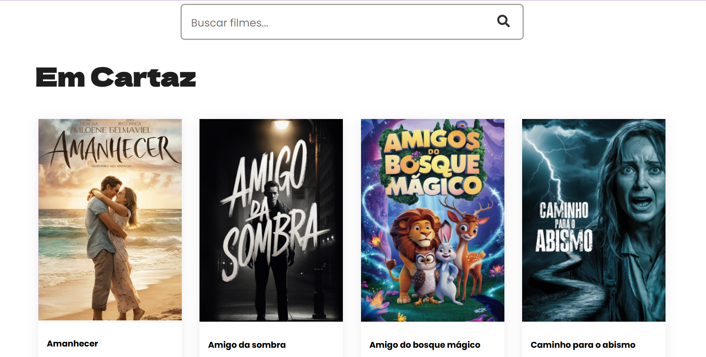
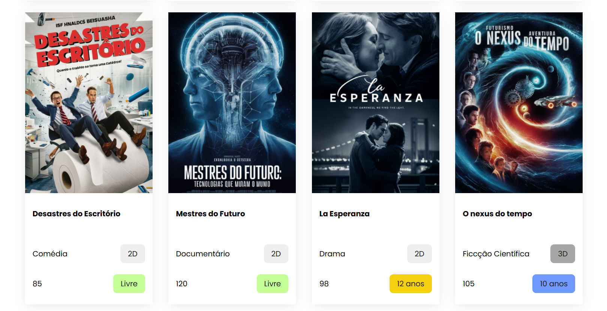
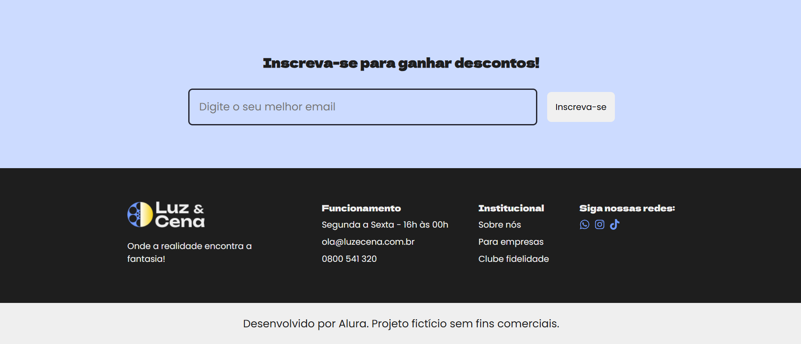

# 🎬 Luz e Cena

**Luz e Cena** é um site de cinema onde o usuário pode conhecer os filmes em cartaz, buscar por títulos, ver detalhes de cada sessão e aproveitar promoções, como combos de ingresso e pipoca. O projeto foi desenvolvido como parte dos estudos de front-end com React e TypeScript.

<p>
  
  
  
  
  
</p>

## ✨ Funcionalidades

- **Catálogo de filmes** com cards que exibem o pôster e as informações de cada título.
- **Busca por título** para encontrar rapidamente um filme em cartaz.
- **Banners promocionais** (destaque principal e combos), responsivos para desktop, tablet e mobile.
- **Newsletter** para receber noviSdades e a programação do cinema.
- **Cabeçalho com navegação** e atalhos para perfil e carrinho.
- **Rodapé** com informações institucionais, redes sociais (Instagram, TikTok e WhatsApp) e créditos.

## 🛠️ Tecnologias

- [React 19](https://react.dev/) e [TypeScript](https://www.typescriptlang.org/)
- [Vite](https://vite.dev/) como bundler
- [Axios](https://axios-http.com/) para consumo da API
- [JSON Server](https://github.com/typicode/json-server) para simular o back-end
- [React Icons](https://react-icons.github.io/react-icons/)
- CSS Modules para a estilização dos componentes
- [Oxlint](https://oxc.rs/) para análise de código

## 📁 Estrutura do projeto

```text
src/
├── api/          # Configuração do Axios
├── components/   # Componentes (Header, Banner, MovieSection, CardMovie, Footer...)
├── hooks/        # Hooks customizados (busca e filtro de filmes)
├── types/        # Tipagens TypeScript
└── db.json       # Base de dados local dos filmes
public/           # Imagens, logos, ícones e banners
```

## 🚀 Como executar

Pré-requisito: [Node.js](https://nodejs.org/) instalado.

```bash
# 1. Clone o repositório
git clone git@github.com:martinsalyne97/Luz-e-Cena-Alura.git
cd Luz-e-Cena-Alura

# 2. Instale as dependências
npm install

# 3. Inicie a API local (porta 3001)
npm run server

# 4. Em outro terminal, inicie o site
npm run dev
```

O site ficará disponível no endereço exibido pelo Vite (normalmente `http://localhost:5173`).

## 📜 Scripts disponíveis

| Comando           | Descrição                                  |
| ----------------- | ------------------------------------------ |
| `npm run dev`     | Inicia o servidor de desenvolvimento       |
| `npm run server`  | Inicia a API local com o JSON Server       |
| `npm run build`   | Gera a versão de produção                  |
| `npm run preview` | Visualiza a build de produção localmente   |
| `npm run lint`    | Executa a análise de código com o Oxlint   |

## 👩‍💻 Autoria

Projeto desenvolvido por **Alyne Martins**, com base no curso da Alura.
